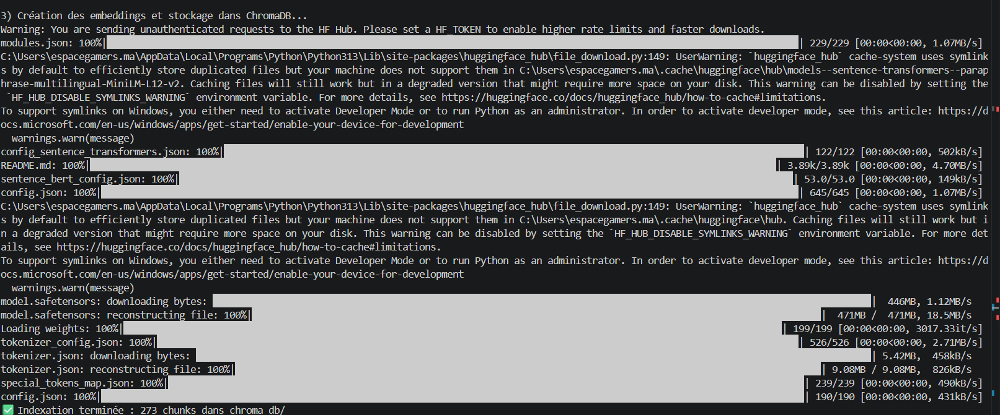
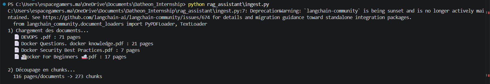
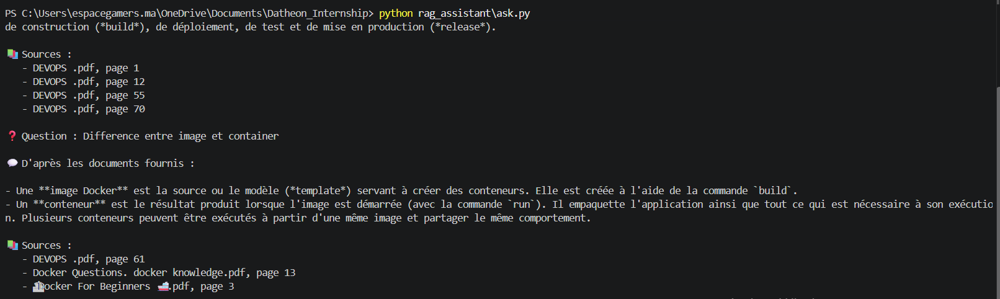
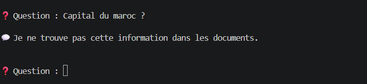
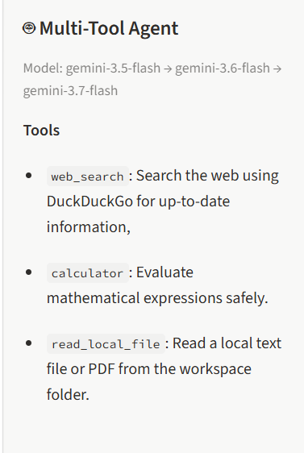
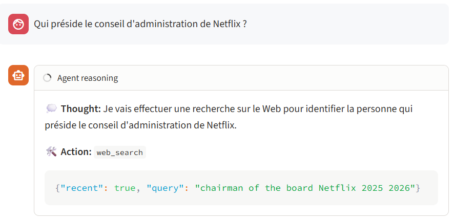

# Datheon Internship: Python + Generative AI & LangChain

Hands-on projects built during the Datheon *Python + Generative AI & LangChain* internship program.

| Task | Project | Status |
|---|---|---|
| 1 | [Structured LLM Prompt Pipeline & JSON Extractor](#task-1--structured-llm-prompt-pipeline--json-extractor) | Done |
| 2 | [Document Q&A Assistant with RAG](#task-2--document-qa-assistant-with-rag--vector-embeddings) | Done |
| 3 | [Multi-Tool Autonomous AI Agent](#task-3--multi-tool-autonomous-ai-agent) | Done |
| 4 | [Interactive Streamlit Chatbot](#task-4--interactive-streamlit-chatbot) | Done |

## Project structure
```
.
├── json_extractor.py        # Task 1: schemas, prompts, LLM clients, pipeline, CLI
├── rag_assistant/           # Task 2
│   ├── data/                # source PDFs (not committed)
│   ├── ingest.py            # phase 1: load, chunk, embed, store
│   ├── ask.py               # phase 2: retrieve, answer, cite pages
│   └── chroma_db/           # vector store (generated, not committed)
├── agent_assistant/         # Task 3
│   ├── agent.py             # agent loop: thought -> action -> observation -> answer
│   ├── tools.py             # web_search, calculator, read_local_file
│   └── workspace/           # files the agent is allowed to read (demo: budget.txt)
├── streamlit_app.py         # Task 4: web UI around the Task 3 agent
├── tests/                   # pytest tests (no real API calls)
├── docs/screenshots/        # demo screenshots
├── requirements.txt
└── .env.example
```

## Installation (all tasks)
```bash
python -m venv venv
venv\Scripts\activate          # Windows  (Mac/Linux: source venv/bin/activate)
pip install -r requirements.txt
```
Copy `.env.example` to `.env` and add your API key(s):
```
GEMINI_API_KEY=your_key
```

> **Free-tier note:** the Gemini free tier allows about 5 requests per minute per model.
> Tasks 3 and 4 make one request per agent step, so long reasoning chains may pause briefly
> while the app waits for the quota to reset.

---

# Task 1 · Structured LLM Prompt Pipeline & JSON Extractor

Turns **unstructured text** (invoices, resumes) into **strictly validated JSON** using an LLM
(Google Gemini or OpenAI), parameterized prompt templates, few-shot examples and Pydantic schemas.

## Features
- Two providers behind one interface: **Gemini** (`google-genai`) 
- **Parameterized prompt templates** (document type, rules, JSON schema and examples injected at runtime)
- **Few-shot examples** generated from Pydantic objects (always valid by construction)
- **Pydantic v2 validation** with business rules (e.g. `total = subtotal + tax`, line totals, date order)
- **Self-repair loop**: if the output is invalid, the validation error is sent back to the model (max N retries)
- Extensible: add a new document type with one schema + one `Task`

## Usage
```bash
# Built-in demo documents
python json_extractor.py invoice --demo --provider gemini

# Your own file, saved to JSON
python json_extractor.py invoice --file invoice.txt --output invoice.json

# Inspect the generated prompt without calling any API
python json_extractor.py invoice --demo --show-prompt
```
Options: `--provider {gemini,openai}`, `--model NAME`, `--retries N`, `--output FILE`.

## Example

**Input**
```
INVOICE #INV-889
Issued: 02/09/2025   Payment due: 02/10/2025
From: Nordic Cloud Ltd (VAT: SE556677889901), Storgatan 5, Stockholm. billing@nordiccloud.se
Bill to: Casa Logistics, 45 Bd Zerktouni, Casablanca
Description                    Qty   Unit     Amount
Cloud compute (monthly)         3    120.00   360.00
Premium support                 1    250.00   250.00
Subtotal 610.00 EUR  | VAT 25% 152.50 EUR | TOTAL DUE 762.50 EUR
```

**Output** (validated)
```json
{
  "invoice_number": "INV-889",
  "issue_date": "2025-09-02",
  "due_date": "2025-10-02",
  "vendor": {
    "name": "Nordic Cloud Ltd",
    "address": "Storgatan 5, Stockholm",
    "email": "billing@nordiccloud.se",
    "tax_id": "SE556677889901"
  },
  "customer": {
    "name": "Casa Logistics",
    "address": "45 Bd Zerktouni, Casablanca",
    "email": null,
    "tax_id": null
  },
  "currency": "EUR",
  "line_items": [
    {"description": "Cloud compute (monthly)", "quantity": 3.0, "unit_price": 120.0, "total": 360.0},
    {"description": "Premium support", "quantity": 1.0, "unit_price": 250.0, "total": 250.0}
  ],
  "subtotal": 610.0,
  "tax_amount": 152.5,
  "total": 762.5
}
```

**Terminal demo**


## How it works
```
raw text → prompt template (rules + schema + few-shot) → LLM → clean_json → json.loads
        → Pydantic validation → valid? yes → result
                                      no  → send error back to the LLM → retry (max N)
```

## Design choices
- **Temperature 0 + native JSON mode** for stable, parseable output.
- **Two validation layers**: syntax (`json.loads`) then content (Pydantic).
- **Provider abstraction** (`LLMClient`) so the pipeline never depends on a specific SDK.
- **Prompt rule "use null, never invent data"** to limit hallucinations on missing fields.

---

# Task 2 · Document Q&A Assistant with RAG & Vector Embeddings

A Retrieval-Augmented Generation (RAG) system that answers questions **strictly from custom PDF documents**
and **cites the source pages**. If the answer is not in the documents, it says so instead of guessing.

## Features
- **PDF/text loading** with LangChain loaders (page number kept as metadata)
- **Recursive chunking** (800 characters, 150 overlap)
- **Local multilingual embeddings** (`paraphrase-multilingual-MiniLM-L12-v2`): free, no API key, works in French and English
- **ChromaDB** persistent vector store (index once, query many times)
- **Strict prompt**: answers only from the retrieved context, fixed refusal sentence otherwise
- **Verifiable citations**: chunks are numbered, the model declares which ones it used, and only those pages are displayed
- **Interactive and one-shot modes** (`-q`)

## Usage
```bash
# 1. Put your PDFs in rag_assistant/data/, then index them (once)
python rag_assistant/ingest.py

# 2a. Interactive mode
python rag_assistant/ask.py

# 2b. One-shot mode
python rag_assistant/ask.py -q "What are volumes used for in Docker?"
```

## How it works
```
INDEXING (ingest.py, once)
PDF → PyPDFLoader → RecursiveCharacterTextSplitter → embeddings → ChromaDB

QUESTION (ask.py, every query)
question → embedding → top-k similar chunks → numbered context + strict prompt
        → Gemini → answer + "SOURCES: n" → parse → display only the cited pages
```

| Component | Choice |
|---|---|
| Loader | `PyPDFLoader` (one page = one document) |
| Splitter | `RecursiveCharacterTextSplitter` (800 / 150) |
| Embeddings | `paraphrase-multilingual-MiniLM-L12-v2` (local) |
| Vector store | ChromaDB, `k = 4` |
| LLM | Gemini (`gemini-flash-latest`), temperature 0 |

## Demo

**1. Indexing** (4 PDFs, 116 pages, 273 chunks)




**3. Only the page actually used is cited** (not all 4 retrieved chunks)



**4. Refusal when the information is absent** (no source displayed)




## Design choices
- **Retrieval and generation are separated**: the LLM never sees the whole corpus, only the top-k chunks.
- **Numbered context for citations**: showing all retrieved chunks would cite pages the model never used.
- **Local embeddings**: no quota, no cost, reproducible. The same model must be used at indexing and query time.
- **Offline mode** (`HF_HUB_OFFLINE=1`) in `ask.py` once the model is cached, to avoid network retries.
- **`temperature = 0`** for factual, repeatable answers.

## Known limitations
- Scanned PDFs (images) are not supported: no OCR.
- The embedding model truncates inputs beyond ~128 tokens, which may affect 800-character chunks.
- Citations are declared by the LLM: far more faithful than listing all chunks, but not 100% guaranteed.
- Retrieval can vary slightly with the wording of the question.

---

# Task 3 · Multi-Tool Autonomous AI Agent

A console agent that **decides by itself which tool to use**, chains several tools for compound questions,
and prints its full reasoning chain: **thought → action → observation → final answer**.

## Features
- **Three tools** bound to Gemini through native function calling (LangChain `@tool`):

| Tool | Purpose |
|---|---|
| `web_search` | DuckDuckGo search, with a `recent` option (last year only), automatic retries and today's date stamped on the results |
| `calculator` | Safe math evaluator (AST-based: no `eval`), supports `+ - * / ** % //`, `sqrt`, `log`, `sin`, `min`, `max`, `pi`... |
| `read_local_file` | Reads `.txt .md .csv .json .py .pdf` from the `workspace/` folder only, or lists the available files with `.` |

- **Visible reasoning chain** printed at each step
- **Multi-step planning**: compound questions are split into steps (read file → calculate → search → calculate)
- **Model fallback chain** (`gemini-3.5-flash` → `3.6` → `3.7`) if a model is overloaded (503/504)
- **Answers in the user's language**
- **Step limit** (`MAX_STEPS = 8`) to prevent infinite loops

## Usage
Run from the project root:
```bash
# One-shot mode
python -m agent_assistant.agent -q "Read budget.txt and tell me the total after adding 20% tax"

# Interactive mode
python -m agent_assistant.agent

# Self-test of the tools (calculator, file security, search)
python -m agent_assistant.tools
```

## Example
```
AGENT STEP 1
THOUGHT:  I am going to read the contents of `budget.txt`...
ACTION:   read_local_file   {'path': 'budget.txt'}
OBSERVATION: Budget projet 2026 Serveurs cloud : 4500 MAD par mois ...

AGENT STEP 2
THOUGHT:  I will use the calculator to compute the subtotal...
ACTION:   calculator   {'expression': '4500 * 12 + 12000 + 8000'}
OBSERVATION: 74000

AGENT STEP 3
ACTION:   calculator   {'expression': '74000 * 1.20'}
OBSERVATION: 88800.0

FINAL ANSWER: The total with 20% tax is 88,800 MAD.
```

## How it works
```
question → Gemini (tools bound)
        → tool_calls? ── no ──→ final answer
              │ yes
              ▼
        run tool(s) → ToolMessage (observation) → back to Gemini → next step (max 8)
```

## Design choices
- **Safe calculator**: the expression is parsed into an AST and only whitelisted operators and functions are allowed; exponents and result sizes are capped. `__import__('os')...` is rejected.
- **Sandboxed file reader**: paths are resolved and must stay inside `workspace/` (blocks `../` tricks and symlinks), with an extension whitelist and a size limit.
- **Freshness-aware search**: DuckDuckGo results can be old, so the tool can filter to the last year, stamps today's date on results, and the system prompt asks for the year in the query and the source dates in the answer.
- **Visible reasoning by prompt design**: the model must explain each action in one sentence before calling a tool.
- **Resilience**: retries on search errors and a fallback chain of models.

## Known limitations
- The Gemini free tier (about 5 requests/minute per model) can pause or stop long reasoning chains.
- DuckDuckGo snippets can be outdated or incomplete; the agent may need a second search to confirm recent facts.
- The console mode has no memory between questions (the Streamlit app in Task 4 does).
- Tools are checked with the manual self-test (`python -m agent_assistant.tools`); there are no pytest tests for Task 3 yet.

---

# Task 4 · Interactive Streamlit Chatbot

A browser chat application that wraps the Task 3 agent, with **token-by-token streaming**,
**conversation memory** and **clean session management**.

## Features
- Chat interface built with `st.chat_message` and `st.chat_input`
- **Real-time streaming**: the answer appears word by word
- **Conversation memory** in `st.session_state`: follow-up questions work ("now with 10% tax?")
- **Reasoning chain per answer** in a collapsible block (thought, action, observation), kept when the page refreshes
- **New conversation** button that fully resets the history and the agent's memory
- **Quota-aware**: on a Gemini 429 error the app waits for the delay Google suggests and retries, with a message in the UI
- **Error-safe**: a failed turn is rolled back so the memory is never left in an invalid state

## Usage
Run from the project root (the folder containing `agent_assistant/`):
```bash
streamlit run streamlit_app.py
```
The app opens at `http://localhost:8501`.

**Screenshots**






## How it works
```
st.chat_input → add HumanMessage to st.session_state.messages
   loop (max 8 steps):
      agent.stream(messages) → chunks → live display (streaming)
      tool calls?  yes → run tools → ToolMessage → next step   (text shown as "thought")
                   no  → streamed text is the final answer
→ save the answer and its reasoning steps in st.session_state.chat
```

Two lists live in the session state:

| Key | Content |
|---|---|
| `messages` | Full LangChain history sent to the model (the memory) |
| `chat` | What the UI displays: text plus the reasoning steps of each answer |

## Design choices
- **Streaming with tool calls**: each step is streamed and merged chunk by chunk; if it ends with tool calls, the text is shown as the agent's thought, otherwise it is the final answer.
- **No stripping of chunks**: spaces at chunk boundaries are kept so words are not glued together.
- **Cached agent** (`st.cache_resource`): the model clients are created once, not on every rerun.
- **Rollback on failure**: messages added during a failed turn are removed.

## Known limitations
- Memory lives in the browser session: it is lost on page reload or when the server stops (no database).
- Very long conversations grow the context sent to the model on every step.
- The same free-tier rate limits as Task 3 apply.

---

## Tests
```bash
python -m pytest
```
Tests use no real API calls: Task 1 uses a fake LLM client (validators, JSON cleaning, retry loop);
Task 2 tests the pure functions (source formatting, citation parsing, text extraction).

## Next steps
- Plug the RAG pipeline (Task 2) into the agent as a fourth tool, so the chatbot can answer from the indexed PDFs.
- Add pytest tests for the Task 3 tools (calculator and file-reader security).
- Persist chat history between sessions.

## Author

**Bouzagrar Siham**
- GitHub: [SihamBouzagrar](https://github.com/SihamBouzagrar)
- LinkedIn: [Siham Bouzagrar](https://www.linkedin.com/in/siham-bouzagrar-262711251)
-  Live demo : [https://datheonpython-generativeai-langchaininternshipgit-bf8iyezw7lqh.streamlit.app/]

Built as part of the Datheon *Python + Generative AI & LangChain* internship.
