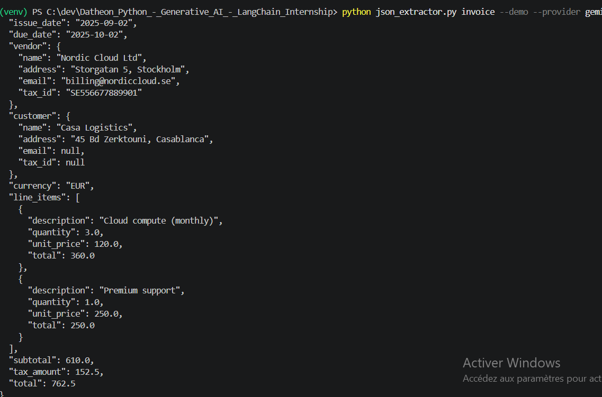

# Structured LLM Prompt Pipeline & JSON Extractor

Task 1 of the *Python + Generative AI & LangChain* internship program.

Turns **unstructured text** (invoices, resumes) into **strictly validated JSON** using an LLM
(Google Gemini or OpenAI), parameterized prompt templates, few-shot examples and Pydantic schemas.

## Features
- Two providers behind one interface: **Gemini** (`google-genai`) and **OpenAI**
- **Parameterized prompt templates** (document type, rules, JSON schema and examples injected at runtime)
- **Few-shot examples** generated from Pydantic objects (always valid by construction)
- **Pydantic v2 validation** with business rules (e.g. `total = subtotal + tax`, line totals, date order)
- **Self-repair loop**: if the output is invalid, the validation error is sent back to the model (max N retries)
- Extensible: add a new document type with one schema + one `Task`

## Project structure
```
json_extractor.py        # schemas, prompts, LLM clients, pipeline, CLI
tests/                   # pytest tests (no real API calls)
requirements.txt
.env.example
```

## Installation
```bash
python -m venv venv
venv\Scripts\activate          # Windows  (Mac/Linux: source venv/bin/activate)
pip install -r requirements.txt
```
Copy `.env.example` to `.env` and add your API key(s).

## Usage
```bash
# Built-in demo documents
python json_extractor.py invoice --demo --provider gemini
python json_extractor.py resume  --demo --provider openai

# Your own file, saved to JSON
python json_extractor.py invoice --file invoice.txt --output invoice.json

# Inspect the generated prompt without calling any API
python json_extractor.py invoice --demo --show-prompt
```
Options: `--provider {gemini,openai}`, `--model NAME`, `--retries N`, `--output FILE`.

## Example

**Input**
```
INVOICE #INV-889
Issued: 02/09/2025   Payment due: 02/10/2025
From: Nordic Cloud Ltd (VAT: SE556677889901), Storgatan 5, Stockholm. billing@nordiccloud.se
Bill to: Casa Logistics, 45 Bd Zerktouni, Casablanca
Description                    Qty   Unit     Amount
Cloud compute (monthly)         3    120.00   360.00
Premium support                 1    250.00   250.00
Subtotal 610.00 EUR  | VAT 25% 152.50 EUR | TOTAL DUE 762.50 EUR
```

**Output** (validated)
```json
{
  "invoice_number": "INV-889",
  "issue_date": "2025-09-02",
  "due_date": "2025-10-02",
  "vendor": {
    "name": "Nordic Cloud Ltd",
    "address": "Storgatan 5, Stockholm",
    "email": "billing@nordiccloud.se",
    "tax_id": "SE556677889901"
  },
  "customer": {
    "name": "Casa Logistics",
    "address": "45 Bd Zerktouni, Casablanca",
    "email": null,
    "tax_id": null
  },
  "currency": "EUR",
  "line_items": [
    {"description": "Cloud compute (monthly)", "quantity": 3.0, "unit_price": 120.0, "total": 360.0},
    {"description": "Premium support", "quantity": 1.0, "unit_price": 250.0, "total": 250.0}
  ],
  "subtotal": 610.0,
  "tax_amount": 152.5,
  "total": 762.5
}
```
**Terminal demo**


## How it works
```
raw text → prompt template (rules + schema + few-shot) → LLM → clean_json → json.loads
        → Pydantic validation → valid? yes → result
                                      no  → send error back to the LLM → retry (max N)
```

## Tests
```bash
python -m pytest
```
Tests use a fake LLM client: they check the validators, the JSON cleaning and the retry loop without any API key.

## Design choices
- **Temperature 0 + native JSON mode** for stable, parseable output.
- **Two validation layers**: syntax (`json.loads`) then content (Pydantic).
- **Provider abstraction** (`LLMClient`) so the pipeline never depends on a specific SDK.
- **Prompt rule "use null, never invent data"** to limit hallucinations on missing fields.

## Next steps (program roadmap)
Task 2: RAG document Q&A · Task 3: multi-tool agent · Task 4: Streamlit chatbot.

## Author

**Bouzagrar Siham**
- GitHub: [https://github.com/SihamBouzagrar]
- LinkedIn: [www.linkedin.com/in/siham-bouzagrar-262711251]

Built as part of the Datheon *Python + Generative AI & LangChain* internship.